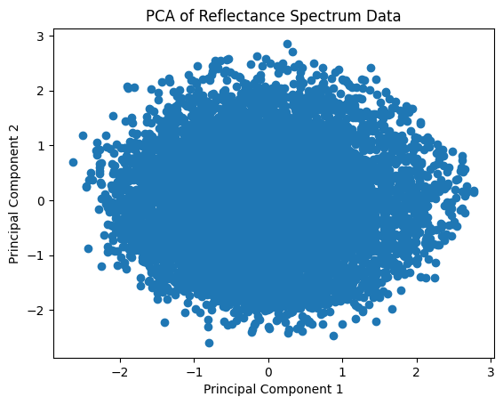

# 💾 반도체 공정 데이터 분석

> **직접 수행한 분석** — 박막 4개 층의 두께와 226개 파장의 반사율을 탐색하고, PCA로 스펙트럼을 3개 주성분으로 축소해 시각화했습니다. (2024.04)

| 노트북 | 데이터 | 내용 |
|---|---|---|
| [`layer_semi.ipynb`](layer_semi.ipynb) | 박막 4개 층 두께 + 반사율 스펙트럼 226개 파장 | 직접 진행한 EDA · 상관 분석 · PCA |
| [`wafermap-practice.ipynb`](wafermap-practice.ipynb) | [WM-811K](http://mirlab.org/dataSet/public/) 웨이퍼맵 811,457장 | 공개 분석 노트북을 따라 하며 불량 패턴 분류 흐름 학습 |

**사용 기술**: Python · pandas · seaborn · Matplotlib · scikit-learn(PCA, 분류 모델)

 

## 1. 박막 두께 분석 (`layer_semi.ipynb`)

반도체 위에 쌓인 4개 박막의 두께를, 빛을 쏘았을 때의 **반사율 스펙트럼**으로 예측하는 문제의 데이터를 탐색했어요.

- **분포 확인** — 층별 두께 히스토그램과 산점도 행렬로 학습·테스트 데이터 분포 비교
- **상관 분석** — 박막 두께(`layer_1~4`)와 226개 스펙트럼 값 사이의 상관 히트맵, 스펙트럼 값끼리의 상관 히트맵
- **차원 축소** — 서로 상관이 높은 스펙트럼 226개를 PCA로 3개 주성분으로 줄여 시각화

> 이웃한 파장끼리 상관이 매우 높아서, 모든 값을 그대로 쓰기보다 **차원 축소나 구간 특성**이 필요하다는 걸 확인했어요.

 

## 2. 웨이퍼맵 불량 패턴 분류 실습 (`wafermap-practice.ipynb`)

실제 팹에서 수집된 웨이퍼맵으로 **Center · Donut · Edge-Loc · Edge-Ring · Loc · Random · Scratch · Near-full** 8가지 불량 패턴을 분류하는 공개 분석을 따라 하며 공부했어요.

- 전체 811,457장 중 라벨이 있는 웨이퍼는 21%뿐이고, 그중 불량 패턴은 3.1%라 **심한 불균형 데이터**
- 웨이퍼 크기가 632가지로 제각각이라 이미지를 그대로 쓰기 어려움 → **밀도 · Radon 변환 · 기하 특징**으로 고정 길이 특성 추출
- [공개 분석 실습 노트북](wafermap-practice.ipynb)에 기록된 테스트 정확도 79%

> 직접 만든 분석이 아니라 **학습용으로 따라 한 노트북**이에요. 제조 데이터에서 "라벨 부족 · 불균형 · 크기가 다른 데이터"를 어떻게 다루는지 익히는 데 썼어요.
